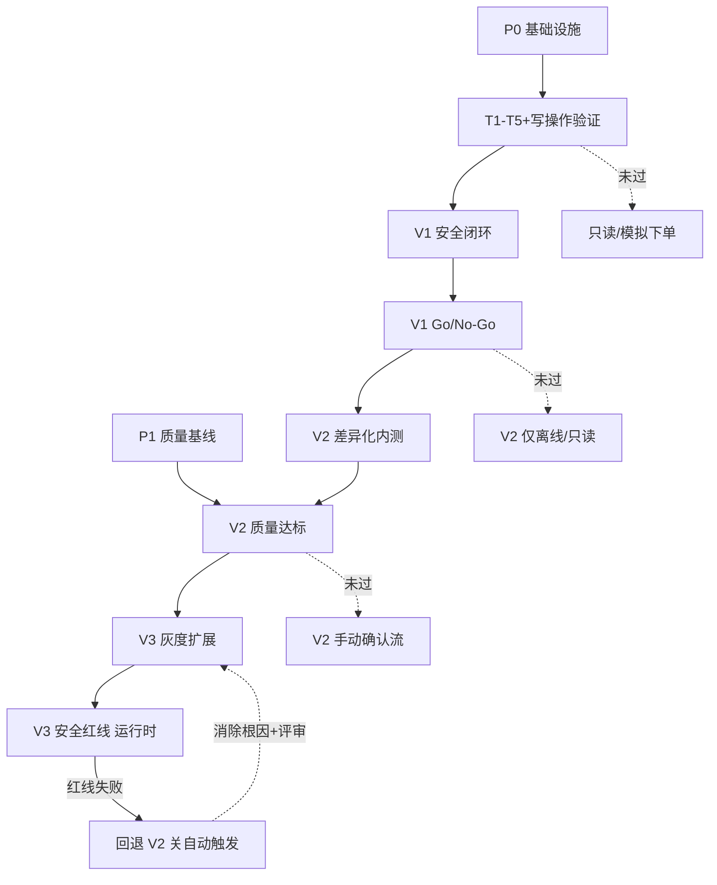

# 麦当劳智能点单 · 依赖关系与关键路径（门禁总控 v1）

> 依据规格「依赖关系与关键路径」（P0 依赖 / P1 依赖 / 顺序约束）编写，
> 是 `txn-security-prompts.md`(3.x)、`diff-internal-test-prompts.md`(4.x)、`gray-release-prompts.md`(5.x) 的**总控与前置闸门**。
> 本文件不新增功能，只定义：依赖清单、阶段门禁、关键路径、阻塞风险与恢复条件。
> 任何阶段推进前必须先过对应门禁（G1–G4）；未过则冻结该阶段能力。

---

## 0. 总览：三阶段 + 四道门禁

```
P0 依赖 ─┐
         ├─► [G1] ─► V1 安全闭环(3.x) ─► [G2] ─► V2 差异化内测(4.x) ─► [G3] ─► V3 灰度扩展(5.x) ─► [G4 运行时]
P1 依赖 ─┘                                                                                      │
                                                                                                 │ 红线失败
                                                                                                 ▼
                                                                                          回退 V2（关自动触发）
```

- **P0 依赖**：写操作接口/权限/沙盒、幂等/状态/重试/取消语义、实时数据时效与口径、安全评审/审计/告警/接管。
- **P1 依赖**：用户研究与任务基线、推荐排序/解释质量/灰度监控能力。
- **门禁 G1–G4**：把「顺序约束」固化为硬前置；任一不过，对应阶段能力冻结。

---

## 1. P0 依赖清单（基础设施，V1 前必须就绪）

| 编号 | 依赖项 | 来源 / 工具 | 验证方式 | 状态跟踪 | 阻塞风险 |
|---|---|---|---|---|---|
| P0-1 | 写操作实际接口、权限、沙盒/测试账号 | `mcp__mcd-mcp__create-order` `cancel-order` `query-order` + 沙盒账号 | 用沙盒跑通 创建→查询→取消 全链路，确认权限与返回字段 | ☐ 待验证 ☐ 就绪 | 无沙盒则只能模拟下单，G1 不过 |
| P0-2 | 订单幂等、状态一致性、重试和取消语义 | 3.x P3 幂等键 + P4 状态/重试/取消 | 同一 idemKey 重发只成单；`query-order` 状态与 `create/cancel` 一致 | ☐ 待验证 ☐ 就绪 | 幂等缺失→重复下单，G1 不过 |
| P0-3 | 实时菜单、库存/门店、券规则和营养数据的时效与口径 | `query-meals` `query-nearby-stores` `delivery-query-stores` `available-coupons` `query-my-coupons` `calculate-price` `list-nutrition-foods` | 抽测同店同餐品 连续两次返回一致；券以 `calculate-price` 为准；营养缺失标「未核实」 | ☐ 待验证 ☐ 就绪 | 口径漂移→价格不一致，G3 不过 |
| P0-4 | 安全/合规评审、审计日志、告警和人工接管机制 | 3.x P5 审计 + P4 接管；5.x P5 熔断/告警 | 一次写操作能落审计（riskLevel+idemKey+orderId）；触发接管能告警并附脱敏快照 | ☐ 待验证 ☐ 就绪 | 无审计/接管→G2/G4 不过 |

**P0 核查提示词**（用于 G1 前自检）：
```
逐项核查 P0-1~P0-4：用沙盒真实接口跑 创建→查询→取消→重试（同 idemKey）全链路；
确认 幂等只成单、状态一致、价格口径来自 calculate-price、写操作均入审计且可触发接管告警。
四项全「就绪」→ P0 通过；任一「待验证」→ 冻结 V1 自动路径，仅允许只读/模拟下单。
```

---

## 2. P1 依赖清单（质量基线，V2/V3 前必须就绪）

| 编号 | 依赖项 | 来源 / 工具 | 验证方式 | 状态跟踪 | 阻塞风险 |
|---|---|---|---|---|---|
| P1-1 | 用户研究和任务基线数据 | 4.x P5 telemetry（采纳/二次修改/轮次/时延） | 内测产出 ≥N 条脱敏任务样本，建立 采纳率/修改率/时延 P50/P90 基线 | ☐ 待建 ☐ 就绪 | 无基线→V2 质量无法判定，G3 不过 |
| P1-2 | 推荐排序、解释质量 | 4.x P2 券后算价 + P4 可解释排序 | 推荐经 `calculate-price` 实测排序；输出含 满足约束/未满足软目标/预估vs实付；无黑箱词 | ☐ 待验证 ☐ 就绪 | 解释不可复算→G3 不过 |
| P1-3 | 自动化灰度监控能力 | 5.x P6 分层监控 + P5 熔断 | 监控能实时取 误触发/重复订单/安全事件/质量基线 并触发熔断 | ☐ 待验证 ☐ 就绪 | 无监控→V3 红线不可感知，G4 失效 |

**P1 核查提示词**（用于 G3 前自检）：
```
核查 P1-1~P1-3：确认 telemetry 已建基线；推荐排序全部基于真实算价且可解释；
分层监控已接入并能对红线(误触发/重复订单/安全事件>0 或质量劣于V2)实时熔断。
三项全就绪 → P1 通过；否则 V3 自动触发保持关闭。
```

---

## 3. 顺序约束 → 门禁 G1–G4（扩展版）

> 每道门禁是可执行检查；输出「放行 / 冻结」结论与证据，写入门禁日志（脱敏）。

### G1 · T1–T5 与写操作验证门禁（进入 V1 自动路径前）
```
前置：3.x T1–T5 全部通过且有证据 + P0-1~P0-2 写操作联调通过。
检查提示词：
  跑 T1(三价一致) T2(确认卡) T3(幂等) T4(异常分支) T5(审计脱敏)；
  用沙盒跑 创建→查询→取消→同键重试，断言 只成单 + 状态一致 + 入审计。
通过标准：T1–T5 全过 + 写操作联调全过。
未过动作：gray_switch.enabled=false，仅 只读 / 模拟下单，禁真实 create-order 自动路径。
恢复条件：补齐 T1–T5 证据 + 写操作联调通过后重跑 G1。
```

### G2 · V1 安全闭环门禁（进入 V2 真实内测前）
```
前置：3.x M1–M3 完成（契约冻结 / 写操作联调 / 受控演练）+ V1 Go/No-Go 通过（含安全评审签字）。
检查提示词：确认 高风险确认覆盖率100% / 重复下单率0 / 安全事件0 / 审计完整 + 评审签字存在。
通过标准：M1–M3 全完成且 Go/No-Go=Go。
未过动作：4.x 仅做离线回放/只读实测，不下真实内测单。
恢复条件：补齐 M1–M3 缺口并通过安全评审后重跑 G2。
```

### G3 · V2 质量门禁（进入 V3 自动触发前）
```
前置：4.x M2–M3 完成 + P1-1~P1-3 就绪 + 指标达标：
  约束满足率 ≥95% / 报价可复算率 ≥99% / 无解解释覆盖率 ≥95% / 无未解释高严重度价格差异。
检查提示词：用 DT1–DT5 回放 + telemetry 基线，逐指标核算是否达标。
通过标准：四项指标全达标。
未过动作：V3 gray_switch 保持关闭，沿用 V2 手动确认流。
恢复条件：定位不达标根因（推荐/算价/解释）→ 回 M2 修补 → 重跑 G3。
```

### G4 · V3 安全红线门禁（运行时）
```
前置：V3 运行中，P0/P1 全就绪。
检查提示词（实时）：监控 5.5 红线——
  误触发率>0 / 重复订单率>0 / 安全事件>0 / 下单或端到端指标 劣于 V2 基线 → 任一触红。
通过标准：红线全 0、质量不劣于 V2。
未过动作：立即 暂停扩灰度 + 回退 V2（关自动触发，仅留手动确认）+ 告警 + 人工接管。
恢复条件：消除根因、连续达标若干周期、经安全评审后重启灰度（canary_pct 从 ≤10% 重新爬坡）。
```

---

## 4. 关键路径（Critical Path）



**关键路径长度（假设，需按实际排期替换）**：
- 最长链：`P0 → G1 → V1(M1→M2→M3) → G2 → V2(M1→M2→M3) → G3 → V3(M1→M2→M3) → G4`。
- 关键浮动：P1（用户研究/基线）可与 V1 并行启动，但必须在 G3 前就绪，否则阻塞 V3。
- 最大风险点：P0-1 沙盒账号与 P0-2 幂等语义——任一项缺失直接卡死 G1，使后续全链无法启动。

---

## 5. 门禁检查总提示词（一次跑完 G1–G4）

```
你是「阶段门禁总控」智能体。按以下顺序执行门禁检查，逐项输出 放行/冻结 + 证据 + 冻结时动作，
最终给一份「阶段推进报告」：

1. G1：T1–T5 证据齐 + P0-1~P0-2 写操作联调过？→ 否：冻结 V1 自动路径（仅只读/模拟）。
2. G2：3.x M1–M3 完成 + V1 Go/No-Go=Go + 安全评审签字？→ 否：冻结 V2 真实内测。
3. G3：4.x M2–M3 完成 + P1 就绪 + 约束满足≥95%/可复算≥99%/无解解释≥95%/无未解释高价差？→ 否：V3 自动触发关闭。
4. G4（运行时）：实时红线（误触发/重复订单/安全事件=0 且质量不劣于V2）？→ 否：暂停扩灰度、回退 V2。

规则：
- 任一门禁「冻结」时，对应阶段能力不得启用；已启用则立即降级（V3→V2 手动流）。
- 所有检查结论与证据写入门禁日志（脱敏，禁明文手机号/地址/支付令牌）。
- 不绕过任何门禁；门禁未过而强行推进视为安全事件，记 FORBIDDEN 并上报。
```

---

## 6. 阻塞风险与缓解

| 风险 | 影响门禁 | 缓解 |
|---|---|---|
| 无沙盒/测试账号 | G1 | 先申请沙盒；过渡期仅 只读/模拟下单，不碰真实写 |
| 幂等键方案未定/接口不支持 | G1 | 3.x P3 客户端幂等键 + 本地幂等表；联调期验证只成单 |
| 实时数据口径漂移（价格/券/营养） | G3 | 所有价格以 `calculate-price` 为准；营养缺失标「未核实」；加口径漂移告警 |
| 缺用户研究/任务基线 | G3 | 4.x P5 telemetry 先建基线；无基线不判 V2 质量 |
| 监控/熔断缺失 | G4 | 5.x P6 + P5 先于 V3 放量就绪；红线不可感知则不开自动触发 |
| 安全评审排期滞后 | G2/G4 | 把评审签字作为 M1/M3 完成判据前置；未签字不推进 |

---

## 7. 用法建议

1. 本文件是总控：3.x/4.x/5.x 各自功能提示词负责「怎么做」，本文件负责「能不能做」。
2. 每进入一个阶段前，先跑第 5 节「门禁检查总提示词」，把报告存档到门禁日志。
3. G1–G4 是硬前置；建议接入 CI/演练脚本，阶段推进自动化前先自动过门禁。
4. 红线（G4）是运行时持续检查，不是一次性；V3 全周期都要监控，失败即回退 V2。
5. 所有日志/报告脱敏；手机号掩码、地址仅城市·地标、禁记支付令牌。
